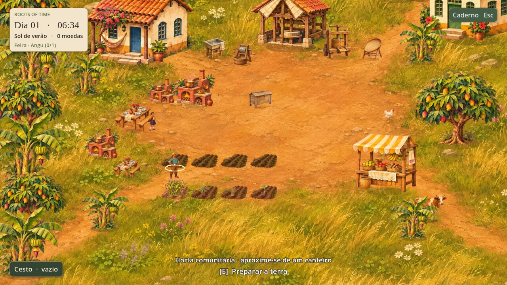

# Roots of Time

Um jogo 2D de agricultura familiar e cozinha artesanal em uma vila brasileira. Prepare o canteiro, plante milho, leve a colheita ao moinho e retire o fubá para cozinhar angu. Sirva as quatro crianças à mesa antes de acompanhá-las até a escola. A mesma vila aceita de uma a seis pessoas.



## Jogar

Abra a pasta do projeto na Godot 4.7.2 estável e pressione F6 na cena `scenes/village.tscn` ou F5 no projeto. No Linux, também é possível iniciar pelo terminal.

```sh
git clone --branch main https://github.com/Noturno-Strange/rootsoftime.git
cd rootsoftime
godot --headless --editor --import
godot
```

| Comando | Ação |
| --- | --- |
| WASD ou setas | Caminhar |
| Shift | Correr |
| E ou F | Usar a estação ou o canteiro próximo |
| Clique esquerdo | Usar o alvo próximo apontado |
| Roda do mouse | Aproximar ou afastar a câmera |
| Esc | Abrir o caderno, consultar receitas, entrar em uma sala ou ajustar opções |

O caderno mostra combinações de ingredientes. Na bancada, deixe o primeiro, busque o segundo e volte para misturá-los. É possível retirar um ingrediente depositado por engano. A bandeja na bancada ao lado do baú aceita quatro porções. Use E com o cesto carregado para apoiar uma porção. Com o cesto vazio, E retira a última porção colocada. Todos os jogadores veem e podem retirar o conteúdo. O baú guarda o conteúdo do cesto e devolve primeiro o último item guardado.

A feira compra pratos e farinha. O pedido exibido no canto superior concede um bônus, e a quantidade do próximo pedido acompanha o tamanho do grupo. Entregue cinco encomendas diferentes para concluir o ciclo da colheita. Com quinze moedas e o cesto vazio, interaja com a feira para restaurar o banco da praça.

## Cooperativo

No caderno, abra **Cooperativo** e escolha **Hospedar**. Os convidados informam o endereço do anfitrião e escolhem **Entrar**. Para uma sala privada, digitem a mesma senha antes de criar ou entrar. A porta é **UDP 31842**. Em uma LAN use o endereço local. Pela internet é necessário que o anfitrião seja alcançável, por encaminhamento da porta ou por uma rede privada entre os participantes. A sessão termina quando o anfitrião sai.

O anfitrião guarda o mundo em `user://vila.save`, com cópia anterior em `vila.save.bak`. Ao sair, os itens carregados vão para o depósito. A carga dos participantes também é preservada no depósito ao reabrir o mundo. As preferências ficam em `user://opcoes.cfg`.

## Testar e exportar

```sh
bash tests/run.sh
godot --script res://tests/visual.gd -- --test
mkdir -p build
godot --headless --export-release Linux
godot --headless --export-release Windows
```

A exportação requer os modelos oficiais da versão 4.7.2 da Godot. Cada preset gera um executável x86-64 com dados incorporados. O teste visual requer sessão gráfica e atualiza as capturas em `reports/`.

O escopo original e o estado desta edição estão em [design](docs/GAME_DESIGN.md), [roteiro](docs/ROADMAP.md) e [relatório de qualidade](docs/QUALITY_CONTROL.md).
